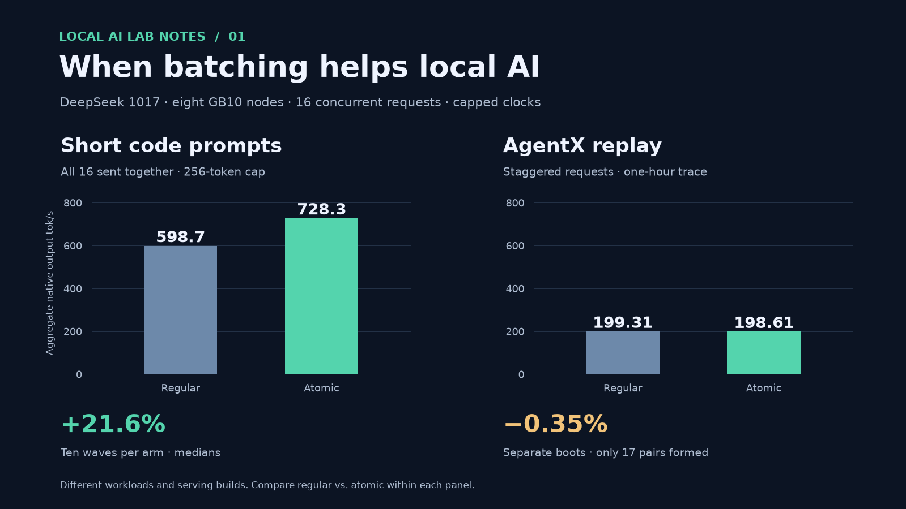

# When batching helps local AI

*Lab Note 01 · November 14, 2026*

I wanted to know whether getting 16 requests into the scheduler together would actually make my local AI agents faster. On eight GB10 machines serving DeepSeek V4.1 Flash 1017, it helped a short benchmark by **21.6%**. A separate replay of staggered agent traffic came back essentially flat. The most useful thing I learned was to check how many requests actually get grouped before tuning the batch size.

## Send sixteen requests together

The regular API could start scheduling before the entire request group was ready. With atomic admission, the scheduler receives the group together and registers every member before taking another step. It still decides how much work fits in that step.

For the synchronized code cell, the intended group formed in 3 of 10 regular waves and all 10 atomic waves. Median aggregate throughput went from 598.7 to 728.3 native output tokens per second. The short coding prompt used a 256-token output cap, reached during reasoning. Across the whole C16 matrix, all 1,280 outputs matched the reference text and token IDs. No patch was graded by this test. [Method, exact prompts, and per-wave data](https://github.com/jlacroix82/DeepSeek-V4.1-Flash-1017-SGLang-TP8-8x-DGX-Spark/blob/07d2569b71fc11899752a87721a3c79cf3afe40d/docs/VLLM_TP8_FOLLOWUP.md#completed-atomic-c16-test).

## Replay staggered agent requests

In the hour-long, 1107-based C16 AgentX replay, turning batching on produced 17 engine-confirmed two-request groups. It delivered 198.61 native tok/s, compared with 199.31 off, with no request errors in either run. CPU and GPU were capped at 2 GHz for both arms because of cooling. These were separate boots and a different build and workload from the short test. The replay shows how rarely pairing occurred under this configuration; it doesn’t isolate why. [Replay results and caveat](https://forums.developer.nvidia.com/t/deepseek-v4-1-flash-on-8x-dgx-spark-tp8-ep8-concurrency-results/387537/19).

For interactive work, I’d look first at elapsed time to the first executable tool call. For background work, I’d measure how many checked tasks finish and see what happens with a short queue. In a separate Hermes experiment, eight background workers brought the first foreground tool call sooner, while sixteen finished more synthetic background work per active hour. [Hermes dispatch experiment](https://github.com/jlacroix82/DeepSeek-V4.1-Flash-1017-SGLang-TP8-8x-DGX-Spark/blob/07d2569b71fc11899752a87721a3c79cf3afe40d/docs/HERMES_BATCHING.md).

Thanks to [Christopher Owen](https://github.com/christopherowen/spark-ds41f) for publishing the original recipe, prompts, and benchmark receipts. If you’re trying this on your own cluster, I’d be interested in how often your requests arrive together and what that does to the time a person waits.

[Chart data](../data/batching-c16.csv) · [Back to the lab index](../README.md)
