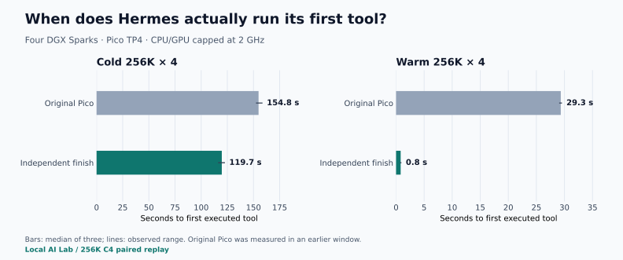

# When a finished turn waits for its batch

*Lab Note 03 · November 14, 2026*

Pico could send Hermes a complete tool call in **0.87 seconds** and still make it wait **28.7 seconds** to run that tool. This happened alongside four warm 256K requests on four DGX Sparks. Letting Pico close each finished turn independently cut that wait to **0.82 seconds** at the median. All nine Hermes checks in the patched run saved the right state exactly once.

## What changed

The [patch](../patches/pico-independent-turns/independent-done.patch) lets Pico tell its existing frontend that a request is done when that request reaches a terminal condition. Pico still does its session cleanup at the usual batch boundary. The tool client, parser, sampling, and weights were the same. In the warm A/B, Hermes saw the tool call in 0.87 s with the flag off and 0.74 s at the median with it on. The speedup came from what happened **after** that event. On cold batches, Hermes still waited behind four prefills.

| Seconds from dispatch | Earlier stock median (3) | Fresh flag off (1) | Flag on median (3) |
| --- | ---: | ---: | ---: |
| First tool, idle | 0.53 | 1.58 | 0.57 |
| First tool, behind cold C4 | 154.84 | 147.52 | 119.70 |
| First tool, behind warm C4 | 29.35 | 28.65 | 0.82 |
| Checked result, behind warm C4 | 30.85 | 30.16 | 3.07 |

The first warm block used the same frozen requests on both runs of the patched binary. With just the flag changed, its first tool went from 28.65 s to 0.80 s.

## What happened to background throughput

| Background native output tok/s | Earlier stock median (3) | Fresh flag off (1) | Flag on median (3) |
| --- | ---: | ---: | ---: |
| Standalone, cold (tok/s) | 25.9 | 27.7 | 26.8 |
| Standalone, warm (tok/s) | 133.0 | 132.3 | 134.1 |
| With Hermes, cold (tok/s) | 25.9 | 27.3 | 26.9 |
| With Hermes, warm (tok/s) | 127.2 | 130.6 | 127.7 |

These rates include prefill, queueing and decode; they count only the four background replies. In the warm mixed lane the patched median was 2.2% lower than the fresh off run (127.7 vs 130.6 tok/s). The earlier control helps show variation, but one fresh off block cannot establish throughput equivalence. The fresh off run's standalone cold wave finished in 147.7 s, while the earlier cold median was 158.4 s. With the flag on, the last first token took 121.6 s versus 117.6 s fresh off; the main cold decode batch itself was 139.4 vs 136.7 native tok/s.

The workload follows the shape of [orenoa's 256K comparison](https://x.com/orenoa7/status/2121559404587663644) using my own frozen, distinct public-domain prose prompts. I used four switched GB10s, 2 GHz CPU and GPU caps, official DeepSeek V4.1 Flash 1017 (`1bae0e1088993b9b82de08f59de5be5a34e42170`), Pico `f2117916f2a4cac0f79fa41680ebd39bf5d42b51`, and the same draft path. The long requests have a 1,024-output-token cap, thinking off, and temperature zero. The warm arm repeats the exact prompt bytes; the per-wave table reports actual hits. Hermes starts two seconds after the background requests, reads a record, computes and saves the result, and finishes naturally with a receipt.

Both fresh configurations passed the 20-case protocol check. Across the 16 matched prose replies in the fresh A/B, 0 had identical visible text. The benchmark checks timing and tool effects; broader coding quality is outside its scope. The original serving profile was restored after the experiment.

[Per-wave measurements](../data/pico-independent-turns.csv) · [Experimental patch](../patches/pico-independent-turns/independent-done.patch) · [Lab index](../README.md)
