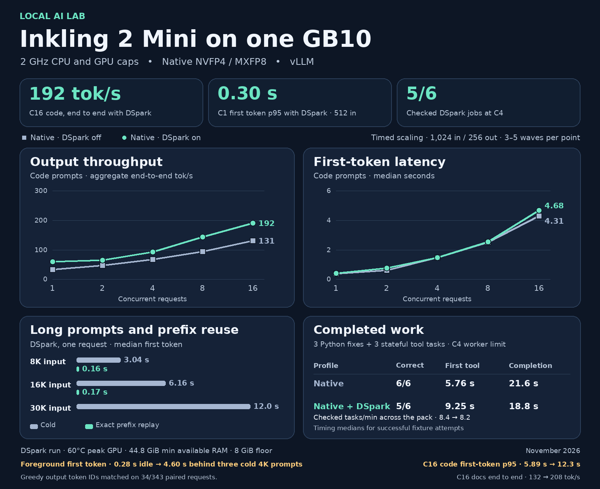

# Inkling 2 Mini on one GB10 at 2 GHz

*Lab Note 05 · November 20, 2026*

See the [vision-enabled suite follow-up](#follow-up-with-vision-enabled) for the local public slices and mixed-work soak.

On one GB10 with 2 GHz CPU and GPU caps, enabling DSpark raised median end-to-end output at 16 concurrent code requests from **131.0 to 191.6 tok/s**, a 46% gain. The same code workload's first-token p95 rose from **5.89 to 12.27 seconds**. Across the two modes I measured 176 timed waves, 686 request streams and 24 checked coding and tool attempts.

## Throughput and first-token latency

Each scaling wave sends distinct 1,024-token prompts and generates 256 tokens per response. The code prompts draw from Python sources and the documentation prompts from technical Markdown in the llama.cpp tree. Each table cell shows **DSpark off → on**. Rates are medians across three waves per mode at C1–C8 and five at C16. Latencies are pooled request medians.

| Concurrent requests | Code output (tok/s) | Code first token (s) | Docs output (tok/s) | Docs first token (s) |
| ---: | ---: | ---: | ---: | ---: |
| 1 | 33.1 → 59.8 | 0.39 → 0.41 | 32.9 → 71.1 | 0.42 → 0.43 |
| 2 | 48.1 → 65.7 | 0.63 → 0.79 | 48.5 → 70.9 | 0.65 → 0.79 |
| 4 | 68.3 → 93.6 | 1.49 → 1.48 | 71.3 → 125.2 | 1.49 → 1.52 |
| 8 | 94.7 → 144.6 | 2.52 → 2.55 | 96.6 → 129.0 | 2.54 → 2.57 |
| 16 | 131.0 → 191.6 | 4.31 → 4.68 | 131.7 → 208.1 | 4.34 → 4.41 |

C16 code waves ranged from **128.8–132.8 tok/s** with DSpark off and **165.4–222.9 tok/s** with it on. The median shared-decode rate on code was 34.7 → 67.2 tok/s at C1 and 157.8 → 317.4 tok/s at C16. Across 24 shorter C1 probes per mode with 512 input and 96 output tokens, first token was 0.25 → 0.28 s at the median and 0.26 → 0.30 s at p95. Those probes delivered 32.6 → 45.8 tok/s end to end.

On larger code prompts, C8 at 2,048 input tokens delivered 83.4 → 114.1 tok/s and a 4.76 → 4.74 s median first token. C4 at 8,192 input tokens delivered 38.5 → 51.3 tok/s and a 9.39 → 9.41 s median first token. Both lanes generated 256 tokens per response. [All speed cells](../data/inkling2-mini-gb10-speed.csv) · [Timed waves](../data/inkling2-mini-gb10-waves.csv) · [Request timings](../data/inkling2-mini-gb10-requests.csv).

## Context, cache reuse, and foreground delay

The context ladder sends one request at a time and generates 128 tokens. Each measured size has three waves per mode. The cache column records the median reported hit for an exact replay.

| Input tokens | Cold first token (s), off → on | Replay first token (s), off → on | Cached tokens on replay |
| ---: | ---: | ---: | ---: |
| 8,192 | 3.03 → 3.04 | 0.17 → 0.16 | 8,128 |
| 16,384 | 6.22 → 6.16 | 0.16 → 0.17 | 16,320 |
| 30,720 | 12.14 → 12.03 | — | — |

Appending 32 tokens to the 8K prompt kept the 8,128-token hit and reached first token in 0.19 → 0.17 s. The foreground probe used a 512-token request. I ran it alone, then sent it about 150 ms behind three cold 4,096-token requests. DSpark off went from 0.26 s idle to 4.58 s busy. DSpark on went from 0.28 s idle to 4.60 s busy. All four figures are medians of three waves. [Cache and foreground requests](../data/inkling2-mini-gb10-requests.csv).

## Checked coding and tool work

The pack contains three Python fixes with external assertions and three stateful tasks that read a local JSON fixture and save a checked result. The harness verifies the final answer and exactly one successful write per passed job. I ran the six tasks once per worker limit and mode using the chat endpoint, low reasoning effort, up to four turns, 768 generated tokens per turn, and a 100-second task budget.

| Worker limit | DSpark | Passed | First complete tool call p50 | Checked completion p50 | Checked tasks/min |
| ---: | --- | ---: | ---: | ---: | ---: |
| 1 | Off | 6/6 | 3.07 s | 12.97 s | 4.45 |
| 1 | On | 6/6 | 0.57 s | 4.31 s | 9.72 |
| 4 | Off | 6/6 | 5.76 s | 21.59 s | 8.36 |
| 4 | On | 5/6 | 9.25 s | 18.77 s | 8.21 |

The latency medians use successful attempts. Checked tasks/min includes the time spent on every attempt. One DSpark C4 Python fix reached the turn token limit midway through its submission call and made zero writes. Each C4 result comes from one six-task run. [Workflow summaries](../data/inkling2-mini-gb10-tasks.csv) · [Every attempt](../data/inkling2-mini-gb10-task-attempts.csv).

## Runtime and measurement details

Both runs used the official Thinking Machines checkpoint at `ed40e7da625f594fc9c4990f5f66be24873c22d7` and the same pinned ARM64 vLLM image (`0.1.dev25855+g7cb5dae22`). The text-only profile used native NVFP4/MXFP8, a 32,768-token context limit, up to 16 active sequences, a 4,096-token batch budget, a 0.50 GPU memory utilization target and prefix caching. DSpark used seven draft tokens with probabilistic draft sampling. I ran DSpark on first and the control second, with the client on the serving host. [Model card](https://huggingface.co/thinkingmachines/Inkling-2-Mini) · [vLLM recipe](https://recipes.vllm.ai/thinkingmachines/Inkling-2-Mini) · [Pinned runtime and checkpoint hashes](../data/inkling2-mini-gb10-results.json).

| Observed resource or runtime metric | DSpark off | DSpark on |
| --- | ---: | ---: |
| Server startup to API readiness | 143.4 s | 227.5 s |
| Engine-reported KV capacity | 148,089 tokens | 121,754 tokens |
| Maximum active requests in engine logs | 16 | 16 |
| Minimum available RAM | 43.7 GiB | 44.8 GiB |
| Peak GPU temperature | 60°C | 60°C |
| Peak ACPI temperature | 63.2°C | 64.5°C |
| Peak driver-reported GPU draw | 32.8 W | 33.1 W |

The guards used an 8 GiB available-memory floor, an 80°C GPU cutoff and a 90°C ACPI cutoff. Available RAM and temperature include the effect of resident host services. Power comes from sampled GPU driver readings.

- **End-to-end output** divides native generated tokens by the interval from first client send to last terminal response. The speed lanes use fixed output budgets, greedy sampling and native token IDs. Cold lanes verify zero cached input tokens. Timed rows exclude warmups and startup.
- **Shared decode** counts native tokens in the middle 80% of the interval when every stream is generating. First-token latency starts at client send and stops at the first streaming event with a generated token ID. The speed CSV includes p95 for cells with at least 20 request observations.
- **Workflow completion** includes parsing the model's tool calls, running the fixture tools and checking the result. First-tool latency stops when the streamed tool-call turn ends and the harness can run the parsed call.
- **Output agreement** was exact on 34 of 343 pairs with matched input token IDs and greedy sampling. Within each mode, all six exact prefix replays also returned a different sequence from their cold counterpart. All 686 timed streams returned their expected token count. Across the speed campaign, aggregate engine counters recorded 61,423 accepted draft tokens out of 149,632 proposed, including warmups between timed blocks. The source of the output differences remains open.

[Complete results and configuration](../data/inkling2-mini-gb10-results.json) · [Lab index](../README.md).

## Follow-up with vision enabled

*Seven-round benchmark suite · November 20, 2026*

I reran the local serving and workflow tests with vision enabled and seven-token DSpark on the same GB10, checkpoint and image. The 20-image pilot scored **19/20**, and the balanced ChartQA test slice scored **10/24**. C16 code reached **200.1 tok/s end to end** on the fresh 1K input and 256-output-token waves.

The profile used 2 GHz CPU/GPU caps, an 8 GiB available-memory floor, the 80°C GPU and 90°C ACPI cutoffs, a 32,768-token context, up to 16 active sequences and one image per request. API readiness took 183.2 s. The runtime reported 121,455 KV tokens. Chat requests used low reasoning effort, temperature zero and seed 1234. [Run identity and scorer pins](../data/inkling2-mini-gb10-suite.json).

### Serving and context

The native-token screen covered 88 timed waves and 343 request streams with 0 failures. The smaller interactive probes reached first token in 0.28 s at the median and 0.30 s at p95 over 24 requests.

| Concurrent requests | Code output (tok/s) | Code first token p50 (s) | Docs output (tok/s) |
| ---: | ---: | ---: | ---: |
| 1 | 59.4 | 0.40 | 68.5 |
| 2 | 67.0 | 0.78 | 82.3 |
| 4 | 91.9 | 1.47 | 111.9 |
| 8 | 147.7 | 2.87 | 141.5 |
| 16 | 200.1 | 4.51 | 191.6 |

The C16 code waves ranged from 191.0 to 210.8 tok/s and first-token p95 was 5.97 s. At 16K, exact prefix reuse moved first token from 6.10 s to 0.18 s. A short foreground request went from 0.27 s alone to 4.58 s behind three cold 4K requests. The separate checked context ladder answered **3/3** ledger questions using values across inputs of 8,209, 16,400, 30,737 actual tokens. [Serving cells](../data/inkling2-mini-gb10-suite-serving.csv).

| Offered rate (req/s) | Completed rate (req/s) | Completed | First token p95 from scheduled arrival (s) |
| ---: | ---: | ---: | ---: |
| 0.5 | 0.41 | 24/24 | 15.28 |
| 1 | 0.94 | 24/24 | 5.05 |
| 2 | 1.29 | 24/24 | 2.60 |

The offered-load screen used one block of 24 paced 512-input and 96-output-token requests per rate, with up to eight client workers. First-token time includes waiting after the scheduled arrival.

### Vision, checked work and local public slices

| Workload | Passed | Hit output cap | First token p50 (s) | Response p50 (s) |
| --- | ---: | ---: | ---: | ---: |
| Synthetic vision pilot | 19/20 | 0 | 0.25 | 1.15 |
| ChartQA · 12 human and 12 augmented test cases | 10/24 | 0 | 0.28 | 2.37 |
| BFCL v4 · reviewed simple Python calls | 20/24 | 1 | 0.39 | 5.22 |
| IFEval · strict prompt-level | 27/32 | 4 | 0.34 | 20.11 |
| MATH-500 · four cases per difficulty level | 19/20 | 1 | 0.32 | 8.57 |
| HumanEval · original tasks 0–11 | 11/12 | 1 | 0.37 | 9.32 |

Latency medians in this table use naturally completed requests.

The pilot scored 4/4 in each of forms, charts, diagrams and counting. OCR passed 3/4. The miss changed one Greek diacritic in an otherwise correct transcription. ChartQA passed 6/12 human and 4/12 augmented cases with the pinned relaxed-accuracy scorer. The scorer counted `41.78%` against `41.78` and `4,863` against `4863` as mismatches. Images ran at one request at a time. [ChartQA](https://github.com/vis-nlp/ChartQA) · [Case receipts](../data/inkling2-mini-gb10-suite-cases.csv).

IFEval also passed 27/32 prompts on loose grading and 39/47 individual instructions on strict grading. BFCL used the upstream AST checker for one streamed native function call per case. MATH-500 used boxed-answer comparison with Math-Verify. HumanEval graded one generated Python implementation per task using the original assertions in an offline CPU-only container. The text slices used four client workers. [IFEval](https://huggingface.co/datasets/google/IFEval) · [BFCL](https://gorilla.cs.berkeley.edu/leaderboard.html) · [MATH-500](https://huggingface.co/datasets/HuggingFaceH4/MATH-500) · [HumanEval](https://github.com/openai/human-eval).

The NVIDIA SPEED-Bench `throughput_1k` local slice used 16 pinned Project Gutenberg prompts, four client workers and 256 native output tokens per request. It completed 16/16 at **35.8 aggregate tok/s** including prefill and queueing. The median actual prompt was 1,175 tokens. [SPEED-Bench](https://huggingface.co/datasets/nvidia/SPEED-Bench).

| Local workflow workers | Passed | First complete tool p50 (s) | Checked tasks/min |
| ---: | ---: | ---: | ---: |
| 1 | 6/6 | 0.57 | 15.16 |
| 4 | 6/6 | 1.00 | 21.34 |

These are local slices with their actual coverage and settings. For context, Vals published 74.58% for Inkling 2 Mini on its proprietary CyberBench v1.1. [Vals CyberBench](https://www.vals.ai/benchmarks/cyber).

### Mixed-work soak

The 906-second soak combined cold 8K prompts, 8K prefix replays, short foreground requests and checked coding or tool jobs with up to four active streams. It completed 288/288 fixed-output requests, with 96 measured replay hits, and 94/96 checked jobs. Median foreground first token was 3.25 s. The two percentage-calculation misses failed assertions before writing a result.

Across the guarded session, GPU temperature peaked at 61°C and ACPI at 64.0°C. The lowest available RAM was 42.5 GiB, and the peak sampled graphics clock was 1,982 MHz. Driver-reported GPU power integrated to 5.55 Wh over 905.2 sampled seconds of the soak. Host swap counters are in the numeric receipt.

[Full suite evidence and settings](../data/inkling2-mini-gb10-suite.json) · [Public and vision case timings](../data/inkling2-mini-gb10-suite-cases.csv) · [All serving cells](../data/inkling2-mini-gb10-suite-serving.csv).
